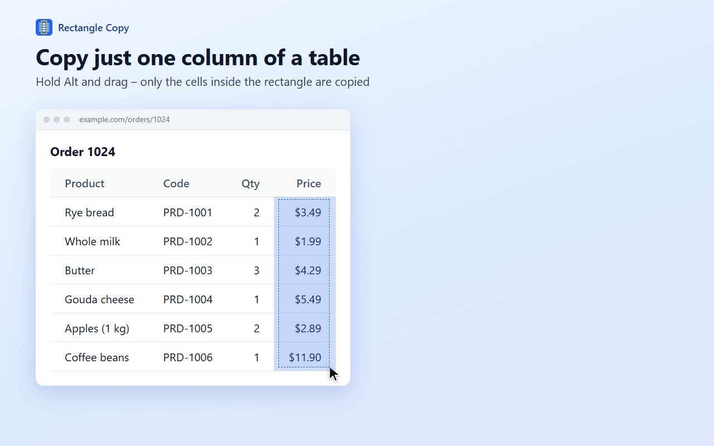
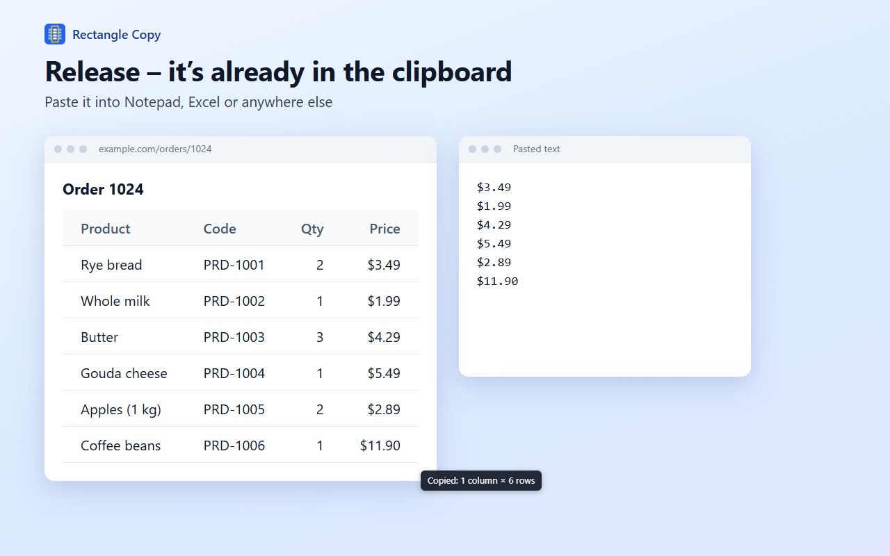

# Rectangle Copy

[Polski](README.pl.md) · [Privacy policy](https://pitprivel.github.io/rectangle-copy/privacy.html) · [☕ Buy me a coffee](https://buycoffee.to/puzzelki-po-godzinach)

A browser extension for Brave, Chrome, Edge and other Chromium browsers. **Hold Alt and drag** to draw a rectangle on the page – when you release the mouse, its contents are already in the clipboard as plain text. Perfect for copying **a single column of a table**, which normal text selection can’t do.




- **Tables:** whole cells are copied. Merged cells (`colspan`/`rowspan`) appear once, hidden rows are skipped, line breaks inside a cell become spaces. Columns are separated by tabs (good for spreadsheets) or aligned with spaces (good for Notepad).
- **Everything else:** characters inside the rectangle are copied line by line, like block selection in code editors. Indentation in monospaced text (code, `<pre>`) is kept.
- What will be copied is highlighted while you drag. The page scrolls by itself near the edge of the window or of a scrollable box. **Esc** cancels. Dragging that starts on a link doesn’t open it.
- Settings in the toolbar popup: key (Alt / Alt + Shift / Ctrl + Alt), column separator, “Copied” message, and turning the extension off on the current site.
- Languages: English, Polski, Deutsch, Français, Italiano, Español, Українська.

**Privacy:** the extension works entirely on your computer. No data collection, no analytics, no network requests. Permissions: access to pages (to draw the rectangle and read the selected text), `clipboardWrite`, `storage` (settings), `activeTab` (turning it off on the current site). See the [privacy policy](https://pitprivel.github.io/rectangle-copy/privacy.html).

## Install

- **[Chrome Web Store](https://chromewebstore.google.com/detail/rectangle-copy/ehfclhgpdpfjhkapbmpgnommgecdpnei)** – works in Brave, Chrome, Edge and other Chromium browsers.
- **Manually:** download `rectangle-copy-<version>.zip` from [Releases](https://github.com/pitprivel/rectangle-copy/releases), unzip it to a permanent folder, open `brave://extensions` (or `chrome://extensions`), turn on **Developer mode** and click **Load unpacked**.

## Development

Requires Node.js 22.

```bash
npm install
npm run build       # dist/        – load it with "Load unpacked"
npm test            # unit tests + end-to-end tests in a real browser (headless)
npm run serve       # test page for manual tries: http://localhost:8765/test/harness.html
npm run pack        # release/rectangle-copy-<version>.zip        (manual install)
npm run pack:store  # release/rectangle-copy-<version>-store.zip  (Chrome Web Store, no "key" field)
npm run stats       # downloads of release files and repo traffic (needs GitHub CLI)
```

End-to-end tests start Brave from its default Windows location; point `BROWSER` to another Chromium-based browser (e.g. Chrome for Testing) and set `HEADFUL=1` to watch them run. Branded Google Chrome 137+ can’t load unpacked extensions from the command line, so use Brave, Chromium or Chrome for Testing.

| Path | Purpose |
|---|---|
| `src/content.js` | mouse handling, overlay with the rectangle and highlight, auto-scroll, clipboard |
| `src/lib/table.js` | table grid with `colspan`/`rowspan`, picking the block of cells, column formatting |
| `src/lib/text.js` | rebuilding text from character positions (lines, spaces, indentation) |
| `src/lib/i18n.js` | translations and plural forms (`Intl.PluralRules`) |
| `src/lib/settings.js` | settings in `chrome.storage.sync`, key matching, per-site switch |
| `src/locales/*.json` | translations (flat files; the build turns them into `_locales`) |
| `src/popup/`, `src/welcome/` | toolbar popup (also the options page) and the welcome page |
| `docs/` | GitHub Pages: home page and privacy policy |

**Translations:** each language is one flat file in `src/locales/`. Tests check that every language has all keys, the same placeholders (`{1}`, `{2}`), all plural forms the language needs, and that the name and description fit the store limits. Corrections are welcome as pull requests.

**Releasing:** bump the version in `src/manifest.json` and `package.json`, add a section to [CHANGELOG.md](CHANGELOG.md), then push a tag `vX.Y.Z`. GitHub Actions runs the tests and attaches both ZIP files to the release.

## Limitations

- Grids built from `<div>`s (e.g. `role="grid"`) are treated as ordinary text – columns come out separated by spaces.
- “Virtual” tables that render only the visible rows can only be copied as far as they are rendered.
- Doesn’t work on content drawn on `<canvas>` (Google Sheets, Docs), in the built-in PDF viewer, on browser pages (`brave://…`, `chrome://…`) or in the Chrome Web Store. Doesn’t look into pages’ Shadow DOM.
- Inside frames (`iframe`) it works, but the selection stays within the frame where it started.

## License

[MIT](LICENSE) © pitprivel
