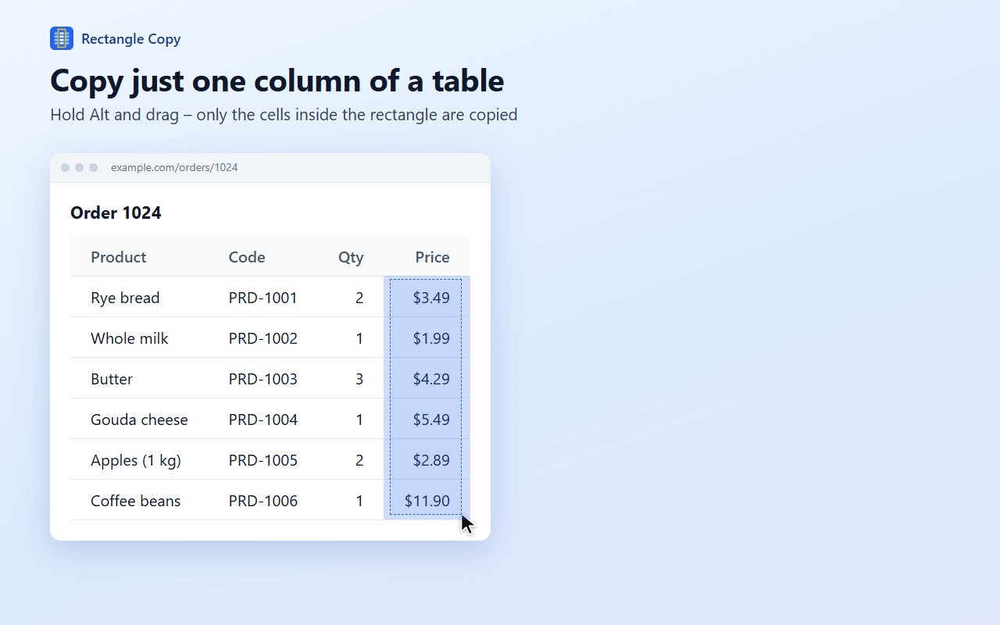

# Rectangle Copy – zaznaczanie prostokątne

[English](README.md) · [Polityka prywatności](https://pitprivel.github.io/rectangle-copy/privacy.html#pl) · [☕ Postaw mi kawę](https://buycoffee.to/puzzelki-po-godzinach)

Dodatek do Brave, Chrome, Edge i innych przeglądarek opartych na Chromium. **Przytrzymaj Alt i przeciągnij myszą** – na stronie rysuje się prostokąt, a po puszczeniu myszy jego zawartość jest już w schowku jako zwykły tekst. Idealne do kopiowania **jednej kolumny tabeli**, czego zwykłe zaznaczanie nie potrafi.



- **Tabele:** kopiowane są całe komórki. Komórki scalone (`colspan`/`rowspan`) pojawiają się raz, ukryte wiersze są pomijane, a łamania wierszy w komórce zamieniają się na spacje. Kolumny rozdziela tabulator (dla arkuszy) albo wyrównanie spacjami (dla notatnika).
- **Reszta strony:** znaki w prostokącie, linia po linii – jak zaznaczanie blokowe w edytorach kodu. W czcionce o stałej szerokości (kod, `<pre>`) zostają wcięcia.
- Podczas przeciągania podświetla się to, co zostanie skopiowane. Przy krawędzi okna albo przewijanego pola strona sama się przewija. **Esc** anuluje. Przeciąganie zaczęte na linku nie otwiera go.
- Ustawienia w okienku pod ikoną: klawisz (Alt / Alt + Shift / Ctrl + Alt), separator kolumn, komunikat „Skopiowano” i wyłączanie dodatku na bieżącej stronie.
- Języki: English, Polski, Deutsch, Français, Italiano, Español, Українська.

**Prywatność:** dodatek działa w całości na Twoim komputerze. Nie zbiera danych, nie ma analityki i nie łączy się z internetem. Uprawnienia: dostęp do stron (rysowanie prostokąta i odczyt zaznaczonego tekstu), `clipboardWrite`, `storage` (ustawienia), `activeTab` (wyłączanie na bieżącej stronie). Szczegóły w [polityce prywatności](https://pitprivel.github.io/rectangle-copy/privacy.html#pl).

## Instalacja

- **Chrome Web Store** – w trakcie weryfikacji.
- **Ręcznie:** pobierz `rectangle-copy-<wersja>.zip` z [Releases](https://github.com/pitprivel/rectangle-copy/releases), rozpakuj do stałego folderu, otwórz `brave://extensions` (albo `chrome://extensions`), włącz **Tryb dewelopera** i kliknij **Załaduj rozpakowane**.

## Rozwój

Wymaga Node.js 22.

```bash
npm install
npm run build       # dist/        – do „Załaduj rozpakowane”
npm test            # testy jednostkowe + testy w prawdziwej przeglądarce (headless)
npm run serve       # strona testowa do ręcznych prób: http://localhost:8765/test/harness.html
npm run pack        # release/rectangle-copy-<wersja>.zip        (instalacja ręczna)
npm run pack:store  # release/rectangle-copy-<wersja>-store.zip  (Chrome Web Store, bez pola "key")
```

Testy w przeglądarce uruchamiają Brave z domyślnej lokalizacji w Windows. Inną przeglądarkę wskażesz zmienną `BROWSER` (np. Chrome for Testing), a `HEADFUL=1` pokaże okno. Zwykły Google Chrome od wersji 137 nie wczytuje rozpakowanych dodatków z wiersza poleceń – użyj Brave, Chromium albo Chrome for Testing.

Opis plików, tłumaczeń i wydawania nowych wersji jest w [README.md](README.md#development).

## Ograniczenia

- Siatki z `<div>`-ów (np. `role="grid"`) są traktowane jak zwykły tekst – kolumny wychodzą rozdzielone spacjami.
- Tabele „wirtualne”, które renderują tylko widoczne wiersze, da się skopiować tylko w zakresie tego, co jest wyrenderowane.
- Nie działa na treściach rysowanych na `<canvas>` (Google Sheets, Docs), we wbudowanym podglądzie PDF, na stronach przeglądarki (`brave://…`) ani w Chrome Web Store. Nie zagląda do Shadow DOM stron.
- W ramkach (`iframe`) działa, ale zaznaczenie nie wychodzi poza ramkę, w której zaczęto.

## Licencja

[MIT](LICENSE) © pitprivel
